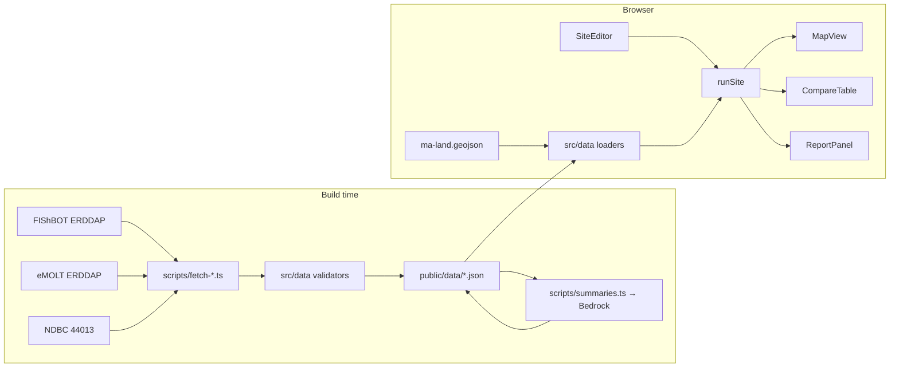

# Design: HeatSink (v2.2)

## Overview
Static Vite + React + TypeScript SPA. Build-time scripts produce JSON snapshots; the browser reads only `/public/data`. All physics and scoring live in `src/model/` as pure functions behind one entry point, `runSite()`, which Person B's UI calls. Equations, constants and properties: steering `thermal-model.md` v2.1 (single source of truth; this doc does not repeat numbers).

## Architecture


## Types (`src/model/types.ts` — create and push FIRST)
```ts
export interface SiteInputs { lat: number; lon: number; facilityMW: number; deltaTC: number; mixRatio: number; heatFraction: number; }

export interface ThermalResult { heatW: number; flowM3s: number; flowMGD: number; totalFlowM3s: number; deltaTEffC: number; decayLengthM: number; reachM: number; }

export interface BaselineCell { id: string; lat: number; lon: number; tempC: number | null; nObs: number; depthM: number | null; }

export interface SamplePoint { lat: number; lon: number; distanceM: number; baselineC: number | null; depthM: number | null; }

export interface PointImpact extends SamplePoint { excessC: number; bottomExcessC: number; combinedC: number | null; deepSurfaceOnly: boolean; }

export interface Species { id: string; name: string; thresholdC: number; source: string; verified: boolean; }

export type Level = 'Low' | 'Medium' | 'High' | 'Insufficient data';

export interface SpeciesRisk { speciesId: string; newlyExceededKm2: number; alreadyExceededKm2: number; score: number; level: Level; }

export interface SiteResult { inputs: SiteInputs; thermal: ThermalResult; points: PointImpact[]; plumeAreaKm2: number; coverage: number; risks: SpeciesRisk[]; }

export class InputRangeError extends Error {}
export class OutfallOnLandError extends Error {}
```

## Model modules (`src/model/`)
| File | Exports | Notes |
|---|---|---|
| constants.ts | all constants | only place numbers live |
| units.ts | toMGD, fromMGD, cToF | |
| thermal.ts | computeThermal(inputs) | validates bounds; heat, flow, mixing, L, reach |
| grid.ts | haversineM, samplePoints(outfall, cells, land) | 250 m grid, disc ≤ R_REF_M, drop land points, attach containing cell baseline/depth |
| plume.ts | excessAt(r, thermal), impacts(points, thermal), sumImpacts(list) | negligible rule first, then shallow-water rule |
| risk.ts | speciesRisk(points, species), coverage(points) | area-based score |
| runSite.ts | runSite(inputs, cells, species, land): SiteResult | throws OutfallOnLandError |
| maxSafe.ts | maxSafeMW(inputs, cells, species, land, speciesIds): { maxMW: number \| null, coverage: number } | binary search over integer MW 1–500; relies on P9; reuses sample points |

Point-in-polygon for the land mask: simple ray casting on a pre-simplified GeoJSON, with a bounding-box precheck per polygon for speed.

## Components (`src/components/`)
MapView (baseline cells, plume rings, exceedance overlay: solid = newly, hatched = already; layer labels MEASURED/MODELED), SiteEditor (presets, bounded sliders, flow card with Brayton line), SpeciesPicker (source + verified badge), CompareTable, ReportPanel, AssumptionsBanner (always visible with results), Footer (sources, fetchedAt). Until runSite lands, B uses a fake SiteResult that satisfies types.ts.

## Share link (`src/data/urlState.ts`, Person B)
encodeState(state) and decodeState(query) → { state, notices }; compact query keys; clamp to bounds in constants.ts; never throw; read on load, write with history.replaceState (debounced); "Copy link" via Clipboard API with fallback.

## Print brief (`src/components/PrintBrief.tsx` + print.css, Person B)
print-only component; @media print hides the interactive UI; map snapshot if feasible, else "map not included"; risk levels as words; includes the share link.

## Data (`scripts/`, `src/data/`)
fetch-fishbot.ts (multi-day window, mean per cell, nObs, depth), fetch-emolt.ts, fetch-ndbc.ts (MM → null), summaries.ts (stretch). Validators return `{ rows, dropped, reasons }`. Snapshots include meta. `species.json` hand-curated; entries without source are filtered at load.

## Performance
~20,000 sample points per site (π·20²/0.0625). Precompute land membership once per outfall; reuse for slider changes (only excess changes). Debounce sliders 100 ms. Target < 500 ms per recompute; four sites in compare are computed once and cached by input key.

## Error handling
Out-of-range inputs → InputRangeError (UI bounds prevent). Land click → OutfallOnLandError → friendly message. Snapshot failure → error card. Missing AI summary → template.

## Testing
- tests/model: properties 1–18 (fast-check), sanity unit test, typed-error tests.
- tests/data: validator properties.
- tests/data: urlState properties 19–20.
- Hook "model tests on save" runs tests/model on `src/model/**` changes.
- Manual demo run twice before the video.

## Out of scope
Tides, currents, stratification, intake entrainment, real permits, real data center locations.
