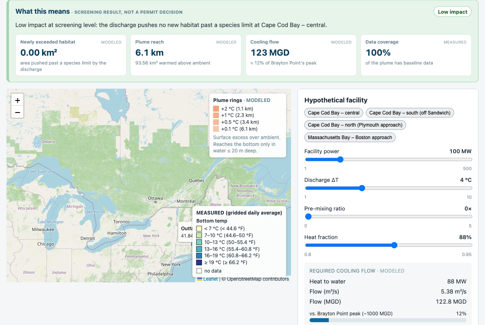
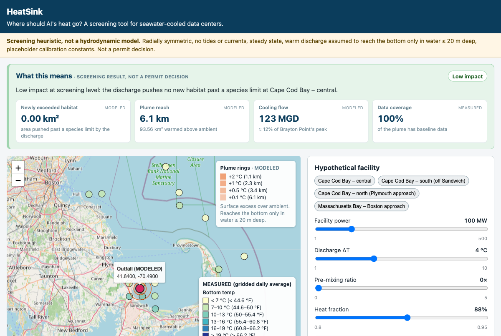
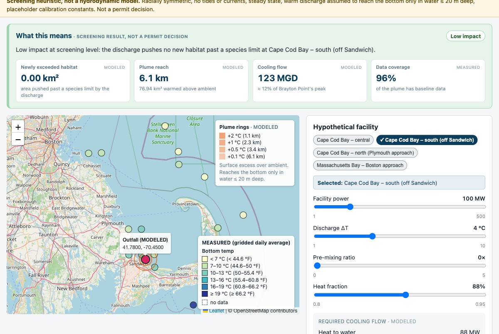
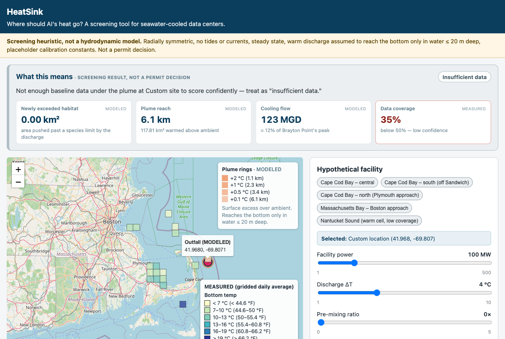

# HeatSink 🌊

**Smart siting for seawater-cooled AI data centers: find where a data center's heat does the least harm to the ocean, before it's built.**

> ⚠️ **Screening tool only.** HeatSink is not a hydrodynamic model or a permit decision. It helps answer "which sites deserve a closer look?"

| | |
|---|---|
| **Live demo** | https://keerthanadevigovindaraj.github.io/HeatSink/ (free, no login) |
| **Demo video (< 3 min)** | https://youtu.be/4AGqKQUWBaI|
| **Track** | ClimaTech & Clean Energy |
| **Built with** | Kiro IDE + Kiro CLI (specs, steering, hooks, MCP, property-based testing) |
| **How Kiro was used** | [docs/HOW_KIRO_WAS_USED.md](docs/HOW_KIRO_WAS_USED.md) |

---

## The problem

AI data centers need cooling. Freshwater cooling is under pressure: Massachusetts has been in drought since October 2024. Seawater cooling avoids using up freshwater, so coastal sites start to look attractive, and seawater-cooled data centers already operate elsewhere (for example, near Hamina, Finland).

But seawater cooling returns the heat to the ocean, typically several degrees warmer than the surrounding water, on top of coastal habitat that is already warm. Massachusetts has seen this before: heated discharge from the Brayton Point power plant into Mount Hope Bay was linked by regulators to harm to species such as winter flounder, and in 2003 the plant was required to sharply cut its heat discharge (the owner disputed responsibility).

**Why now:** Executive Order 658 (September 8, 2026) requires Massachusetts to publish guidance by **December 31, 2026** to help municipalities evaluate data center proposals, including protocols for protecting water resources. Towns will need a fast, transparent way to ask the ocean side of that question.

## Who it's for

- **Town boards and planners** evaluating a data center proposal
- **State reviewers** (e.g., MassDEP) screening sites before detailed modeling
- **Fishers and fisheries advocates** who want to see what's at stake for their grounds

## What it does

1. **Baseline map:** coastal bottom temperatures from fishing-fleet data (FIShBOT grid, eMOLT points), drawn as **true-size ~7 km squares** (honest about the data's resolution), labeled MEASURED, with "no data" shown as empty dashed cells (never interpolated).
2. **Place a hypothetical data center:** 5 preset coastal sites (one selected by default on load) or click-to-place in the water; the active site is highlighted and named. Set facility size (MW), discharge temperature rise, pre-mixing ratio, and heat fraction with bounded sliders.
3. **At-a-glance verdict:** an insights strip turns the result into a plain-English sentence plus color-coded cards — risk level, habitat newly pushed past a limit, plume reach, cooling flow vs. Brayton Point, and data coverage — each tagged MEASURED or MODELED.
4. **Flow and scale:** heat to water, required seawater flow (m³/s and million gallons/day), compared with the old Brayton Point power plant's peak (~1 billion gal/day).
5. **Screening plume:** warm-water rings on the map with plume area and reach, and a shallow-water breakdown (bottom reach vs. surface-only in deep water).
6. **Species check:** area *newly* pushed past cited thermal limits for American lobster (20 °C) and winter flounder (22 °C), shown distinctly from area already above the limit at baseline (solid = newly, hatched = already).
7. **Largest safe size:** for a site and its settings, the biggest plant (MW) that keeps every selected species at Low impact — a planning answer, not just a risk score.
8. **Compare sites:** up to 4 saved sites ranked lowest-to-highest risk, including "Low impact at screening level" and "Insufficient data" when those are the honest answers.
9. **Cumulative mode (stretch):** add several saved sites' plumes together on one shared grid to see a combined footprint.
10. **River-mouth flag (stretch):** overlay diadromous fish sampling stations and flag any within a site's plume reach.
11. **Shareable summary:** a one-page plain-English report (copy or Markdown download) with assumptions, sources, and the screening disclaimer.

## Screenshots


*At-a-glance verdict strip (risk level, newly-exceeded habitat, plume reach, cooling flow vs. Brayton Point, data coverage) above the map and the required-flow card.*


*The map framed on Cape Cod / Massachusetts Bay, showing the outfall, labeled plume rings, and baseline temperature cells.*


*A preset site selected (highlighted) with the species threshold overlay and the "Selected: …" indicator in the facility panel.*

<details>
<summary>More screenshots</summary>


*Overview on load: baseline FIShBOT cells drawn as true-size ~7 km squares, default preset selected.*

</details>

> Note: screenshots are captured with the Playwright MCP from the live app; filenames reflect the shots currently in `docs/screens/`.

## Run locally

Requirements: Node.js 20+ and npm.

```bash
git clone https://github.com/KeerthanaDeviGovindaraj/HeatSink.git
cd HeatSink
npm install
npm run dev      # open http://localhost:5173
npm test         # unit + property-based tests
npm run build    # production build in dist/
```

The app runs fully from committed data snapshots in `public/data/` (no API keys, works offline except map tiles).

Optional: refresh the data snapshots from the original sources:

```bash
npm run data
```

## How the model works

All equations and constants live in [`.kiro/steering/thermal-model.md`](.kiro/steering/thermal-model.md) (single source of truth).

- **Heat to water** = facility MW × heat fraction (default 0.88).
- **Required flow** = heat ÷ (seawater density × specific heat × temperature rise). Sanity check: 90 MW at 5 °C ≈ 4.4 m³/s ≈ 100 million gallons/day.
- **Pre-mixing** lowers discharge temperature and raises flow with the same total heat.
- **Plume:** excess temperature decays exponentially with distance; decay length grows with flow.
- **Fine sampling grid:** 250 m points within 20 km of the outfall; land points removed; each point uses the baseline of the ~7 km FIShBOT cell it falls in.
- **Shallow-water rule:** warm discharge floats, so bottom heating is applied only in water ≤ 20 m deep; deeper points are marked "surface plume only."
- **Score (0–100)** from the area newly pushed past a species limit; levels Low / Medium / High, or "Insufficient data" when less than half the plume has baseline data.
- **Largest safe size** binary-searches facility size (1–500 MW) for the biggest plant that keeps every selected species at Low impact, relying on the proven "more heat never lowers the score" property.

### Correctness

The model is covered by **18 property-based tests** (fast-check), each tied to an EARS requirement (Requirement 10 in [`requirements.md`](.kiro/specs/heatsink/requirements.md)). Examples: heat in equals heat out; the plume is never colder than the surrounding water; more heat never lowers the score; no sample point lies on land; and the largest-safe-size search is correct and never depends on the current slider value. The full suite (model + data + component) is 155 tests.

### Assumptions and limits (shown in the app at all times)

Radially symmetric plume, no tides or currents, steady state, bottom effect only in water ≤ 20 m deep, placeholder calibration constants (decay length, score scale). FIShBOT cells (~7 km) are coarser than most plumes. The eMOLT sample covers one week and is not used to claim trends. Intake effects (fish drawn into pipes) are out of scope.

## Data sources

| Source | Used for | Citation |
|---|---|---|
| FIShBOT bottom temperature | Baseline grid | Commercial Fisheries Research Foundation (ERDDAP) |
| eMOLT bottom temperature | Measured boat points | eMOLT program and the fishing vessels that collected the data |
| NOAA NDBC buoy 44013 | Surface water temperature context | NOAA National Data Buoy Center |
| Massachusetts land polygons | Land mask (on-land outfall rejection, land-point removal) | Natural Earth 1:10m Admin 1 – States, Provinces (public domain) |
| Species thermal thresholds | Lobster and winter flounder limits | Lobster ~20 °C (Tanaka & Chen 2017, DOI 10.1002/2017JC012949); winter flounder ~22 °C (Pereira et al. 1999, NOAA NMFS-NE-138). Full citations in `public/data/species.json` |
| Diadromous fish sampling stations (stretch) | River-mouth reach flag | MassGIS / MA Division of Marine Fisheries, DiadromousFish FeatureServer |
| Policy context | Problem framing | Executive Order 658 (Sept 2026); Massachusetts drought declarations |

## How we used Kiro

The full write-up is in [`docs/KIRO_PLAYBOOK.md`](docs/KIRO_PLAYBOOK.md). In short:

- **Spec-driven development:** requirements → design → tasks in [`.kiro/specs/heatsink/`](.kiro/specs/heatsink/). The spec went through real, documented revisions: v1 → v2 fixed a score formula where more heat could *lower* the risk score; v2 → v2.1 added a land mask and a negligible-first rule after a counterexample to an area property; v2.1 → v2.2 added the largest-safe-size search (plus share-link and print-brief requirements) with two new properties.
- **Steering:** always-on files for product honesty rules, stack conventions, and structure; file-matched files load physics equations only for model code and data rules only for data code.
- **Property-based testing:** 18 physics and scoring properties linked to requirements — these caught the v1 score-monotonicity bug and an area-rule counterexample that example tests would have missed.
- **Agent hooks:** model tests on save, snapshot validation on save, and a manual log hook.
- **MCP:** fetch (confirming real ERDDAP data URLs and schemas), AWS documentation (GitHub Pages / Bedrock deployment steps), and Playwright (driving the live app to debug a blank-basemap tile-URL bug and verify UI changes in-browser).
- **Kiro IDE and Kiro CLI:** engine and UI in the IDE; data pipeline in the CLI.

## Project structure

```
.kiro/          steering, specs (requirements, design, tasks), hooks, MCP settings
docs/           Kiro playbook, team plan, prompts, logs, screenshots
public/data/    committed data snapshots, species.json, land mask
scripts/        data fetch scripts
src/model/      physics and scoring (pure functions, runSite entry point)
src/data/       validators and loaders
src/components/ map, site editor, species, compare table, report
tests/          property-based and unit tests
```

## Team

1) Keerthana Devi Govindaraj 
2) Khushi Lakhlani

## License

MIT, see [LICENSE](LICENSE). Uses open-source libraries including React, Vite, Leaflet, react-leaflet, Vitest, and fast-check under their respective licenses.
